## Completer Request Descriptor Formats

The integrated block transfers each request TLP received from the link over the CQ interface as an independent AXI4-Stream packet. Each packet starts with a descriptor and can have payload data following the descriptor. The descriptor is always 16 bytes long, and is sent in the first 16 bytes of the request packet. The descriptor is transferred during the first two beats on a 64-bit interface, and in the first beat on a 128-bit or 256-bit interface. The formats of the descriptor for diferent request types are illustrated in the following figures. 

The format of the following figure applies when the request TLP being transferred is a memory read/write request, an I/O read/write request, or an Atomic Operation request. 

Figure 17: Completer Request Descriptor Format for Memory, I/O, and Atomic Op Requests

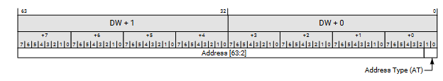

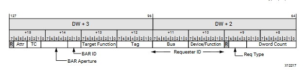

The format of the following figure is used for Vendor-Defined Messages (Type 0 or Type 1) only. 

Figure 18: Completer Request Descriptor Format for Vendor-Defined Messages

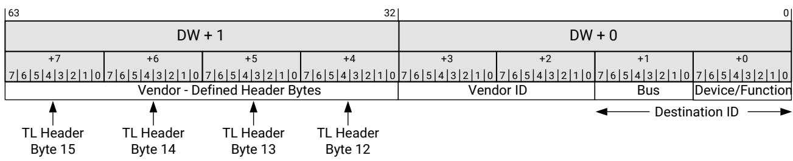

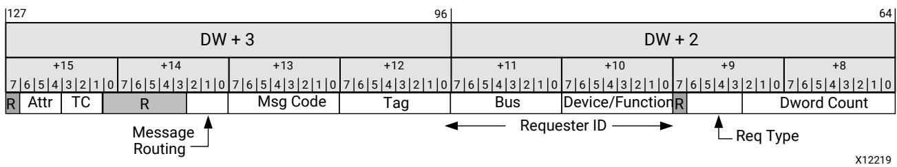

The format of the following figure is used for all ATS messages (Invalid Request, Invalid Completion, Page Request, PRG Response). 

Figure 19: Completer Request Descriptor Format for ATS Messages

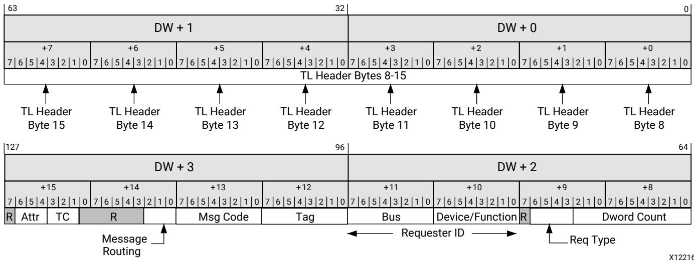

For all other messages, the descriptor takes the format of the following figure.

Figure 20: Completer Request Descriptor Format for All Other Messages

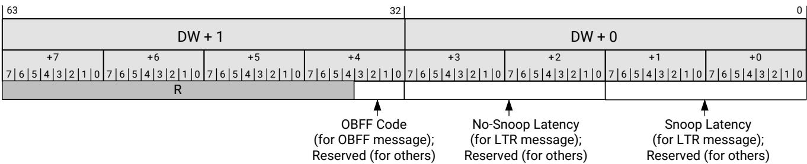

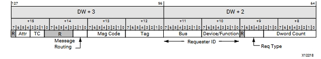

The following table describes the individual fields of the completer request descriptor. 

Table 50: Completer Request Descriptor Fields

<table><tr><td>Bit Index</td><td>Field Name</td><td>Description</td></tr><tr><td>1:0</td><td>Address Type</td><td>This field is defined for memory transactions and Atomic Operations only. It contains the AT bits extracted from the TL header of the request.00: Address in the request is untranslated01: Transaction is a Translation Request10: Address in the request is a translated address11: Reserved</td></tr><tr><td>63:2</td><td>Address</td><td>This field applies to memory, I/O, and Atomic Op requests. It provides the address from the TLP header. This is the address of the first Dword referenced by the request. The First_BE bits from m_axis_cq_tuser must be used to determine the byte-level address.When the transaction specifies a 32-bit address, bits [63:32] of this field are 0.</td></tr><tr><td>74:64</td><td>Dword Count</td><td>These 11 bits indicate the size of the block (in Dwords) to be read or written (for messages, size of the message payload). Its range is 0 - 256 Dwords. For I/O accesses, the Dword count is always 1.For a zero length memory read/write request, the Dword count is 1, with the First_BE bits set to all 0s.</td></tr><tr><td>78:75</td><td>Request Type</td><td>Identifies the transaction type. The transaction types and their encodings are listed in Table 51: Transaction Types.</td></tr><tr><td>95:80</td><td>Requester ID</td><td>PCI Requester ID associated with the request. With legacy interpretation of RIDs, these 16 bits are divided into an 8-bit bus number [95:88], 5-bit device number [87:83], and 3-bit Function number [82:80]. When ARI is enabled, bits [95:88] carry the 8-bit bus number and [87:80] provide the Function number.When the request is a Non-Posted transaction, the user completer application must store this field and supply it back to the integrated block with the completion data.</td></tr></table>

Table 50: Completer Request Descriptor Fields (cont'd)

<table><tr><td>Bit Index</td><td>Field Name</td><td>Description</td></tr><tr><td>103:96</td><td>Tag</td><td>PCIe Tag associated with the request. When the request is a Non-Posted transaction, the user logic must store this field and supply it back to the integrated block with the completion data. This field can be ignored for memory writes and messages.</td></tr><tr><td>111:104</td><td>Target Function</td><td>This field is defined for memory, I/O, and Atomic Op requests only. It provides the Function number the request is targeted at, determined by the BAR check. When ARI is in use, all 8 bits of this field are valid. Otherwise, only bits [106:104] are valid.Following are Target Function Value to PF/VF map mappings:0: PF01: PF12: PF23: PF34: VF05: VF16: VF27: VF3</td></tr><tr><td>114:112</td><td>BAR ID</td><td>This field is defined for memory, I/O, and Atomic Op requests only. It provides the matching BAR number for the address in the request.In RP mode, BAR ID is always 000.001: BAR 1 (VF-BAR 1 for VFs)010: BAR 2 (VF-BAR 2 for VFs)011: BAR 3 (VF-BAR 3 for VFs)100: BAR 4 (VF-BAR 4 for VFs)101: BAR 5 (VF-BAR 5 for VFs)110: Expansion ROM AccessFor 64-bit transactions, the BAR number is given as the lower address of the matching pair of BARs (that is, 0, 2, or 4).</td></tr><tr><td>120:115</td><td>BAR Aperture</td><td>This 6-bit field is defined for memory, I/O, and Atomic Op requests only. It provides the aperture setting of the BAR matching the request. This information is useful in determining the bits to be used in addressing its memory or I/O space. For example, a value of 12 indicates that the aperture of the matching BAR is 4K, and the user application can therefore ignore bits [63:12] of the address.For VF BARs, the value provided on this output is based on the memory space consumed by a single VF covered by the BAR.</td></tr><tr><td>123:121</td><td>Transaction Class (TC)</td><td>PCIe Transaction Class (TC) associated with the request. When the request is a Non-Posted transaction, the user completer application must store this field and supply it back to the integrated block with the completion data.</td></tr><tr><td>126:124</td><td>Attributes</td><td>These bits provide the setting of the Attribute bits associated with the request. Bit 124 is the No Snoop bit and bit 125 is the Relaxed Ordering bit. Bit 126 is the ID-Based Ordering bit, and can be set only for memory requests and messages.When the request is a Non-Posted transaction, the user completer application must store this field and supply it back to the integrated block with the completion data.</td></tr><tr><td>15:0</td><td>Snoop Latency</td><td>This field is defined for LTR messages only. It provides the value of the 16-bit Snoop Latency field in the TLP header of the message.</td></tr><tr><td>31:16</td><td>No-Snoop Latency</td><td>This field is defined for LTR messages only. It provides the value of the 16-bit No-Snoop Latency field in the TLP header of the message.</td></tr></table>

Table 50: Completer Request Descriptor Fields (cont'd)

<table><tr><td>Bit Index</td><td>Field Name</td><td>Description</td></tr><tr><td>35:32</td><td>OBFF Code</td><td>This field is defined for OBFF messages only. The OBFF Code field is used to distinguish between various OBFF cases:1111b: CPU Active - System fully active for all device actions including bus mastering and interrupts.0001b: OBFF - System memory path available for device memory read/write bus master activities.0000b: Idle - System in an idle, low power state.All other codes are reserved.</td></tr><tr><td>111:104</td><td>Message Code</td><td>This field is defined for all messages. It contains the 8-bit Message Code extracted from the TLP header.Appendix F of the PCI Express Base Specification, rev. 3.0 provides a complete list of the supported Message Codes.Users should treat a descriptor with unsupported Message Code as UR, and toggle the signal cfg_err_uncor_in to indicate that Non-fatal error is detected.</td></tr><tr><td>114:112</td><td>Message Routing</td><td>This field is defined for all messages. These bits provide the 3-bit Routing field r[2:0] from the TLP header.</td></tr><tr><td>15:0</td><td>Destination ID</td><td>This field applies to Vendor-Defined Messages only. When the message is routed by ID (that is, when the Message Routing field is 010 binary), this field provides the Destination ID of the message.</td></tr><tr><td>63:32</td><td>Vendor-Defined Header</td><td>This field applies to Vendor-Defined Messages only. It contains the bytes extracted from Dword 3 of the TLP header.</td></tr><tr><td>63:0</td><td>ATS Header</td><td>This field is applicable to ATS messages only. It contains the bytes extracted from Dwords 2 and 3 of the TLP header.</td></tr></table>

Table 51: Transaction Types

<table><tr><td>Request Type (binary)</td><td>Description</td></tr><tr><td>0000</td><td>Memory Read Request</td></tr><tr><td>0001</td><td>Memory Write Request</td></tr><tr><td>0010</td><td>I/O Read Request</td></tr><tr><td>0011</td><td>I/O Write Request</td></tr><tr><td>0100</td><td>Memory Fetch and Add Request</td></tr><tr><td>0101</td><td>Memory Unconditional Swap Request</td></tr><tr><td>0110</td><td>Memory Compare and Swap Request</td></tr><tr><td>0111</td><td>Locked Read Request (allowed only in Legacy Devices)</td></tr><tr><td>1000</td><td>Type 0 Configuration Read Request (on Requester side only)</td></tr><tr><td>1001</td><td>Type 1 Configuration Read Request (on Requester side only)</td></tr><tr><td>1010</td><td>Type 0 Configuration Write Request (on Requester side only)</td></tr><tr><td>1011</td><td>Type 1 Configuration Write Request (on Requester side only)</td></tr><tr><td>1100</td><td>Any message, except ATS and Vendor-Defined Messages</td></tr><tr><td>1101</td><td>Vendor-Defined Message</td></tr><tr><td>1110</td><td>ATS Message</td></tr><tr><td>1111</td><td>Reserved</td></tr></table>

## Completer Memory Write Operation

The following timing diagrams illustrate the Dword-aligned transfer of a memory write TLP received from the link across the Completer reQuest (CQ) interface, when the interface width is configured as 64, 128, and 256 bits, respectively. For illustration purposes, the starting Dword address of the data block being writen into memory is assumed to be (m × 32 + 1), for an integer m > 0. Its size is assumed to be n Dwords, for some n = k × 32 + 29, k > 0. 

In both Dword-aligned and address-aligned modes, the transfer starts with the 16 descriptor bytes, followed immediately by the payload bytes. The m_axis_cq_tvalid signal remains asserted over the duration of the packet. You can prolong a beat at any time by deasserting m_axis_cq_tready. The AXI4-Stream interface signals m_axis_cq_tkeep (one per Dword position) indicate the valid Dwords in the packet including the descriptor and any null bytes inserted between the descriptor and the payload. That is, the tkeep bits are set to 1 contiguously from the first Dword of the descriptor until the last Dword of the payload. During the transfer of a packet, the tkeep bits can be 0 only in the last beat of the packet, when the packet does not fill the entire width of the interface. The m_axis_cq_tlast signal is always asserted in the last beat of the packet. 

The CQ interface also includes the First Byte Enable and the Last Enable bits in the m_axis_cq_tuser bus. These are valid in the first beat of the packet, and specify the valid bytes of the first and last Dwords of payload. 

The m_axi_cq_tuser bus also provides several informational signals that can be used to simplify the logic associated with the user interface, or to support additional features. The sop signal is asserted in the first beat of every packet, when its descriptor is on the bus. The byte enable outputs byte_en[31:0] (one per byte lane) indicate the valid bytes in the payload. The bits of byte_en are asserted only when a valid payload byte is in the corresponding lane (that is, not asserted for descriptor or padding bytes between the descriptor and payload). The asserted byte enable bits are always contiguous from the start of the payload, except when the payload size is two Dwords or less. For cases of one-Dword and two-Dword writes, the byte enables can be non-contiguous. Another special case is that of a zero-length memory write, when the integrated block transfers a one-Dword payload with all byte_en bits set to 0. Thus, in all cases the user logic can use the byte_en signals directly to enable the writing of the associated bytes into memory. 

In the Dword-aligned mode, there can be a gap of zero, one, two, or three byte positions between the end of the descriptor and the first payload byte, based on the address of the first valid byte of the payload. The actual position of the first valid byte in the payload can be determined either from first_be[3:0] or byte_en[31:0] in the m_axis_cq_tuser bus. 

When a Transaction Processing Hint is present in the received TLP, the integrated block transfers the parameters associated with the hint (TPH Steering Tag and Steering Tag Type) on signals within the m_axis_cq_tuser bus. 

Figure 21: Memory Write Transaction on the Completer Request Interface (Dword-Aligned Mode, 64-Bit Interface)

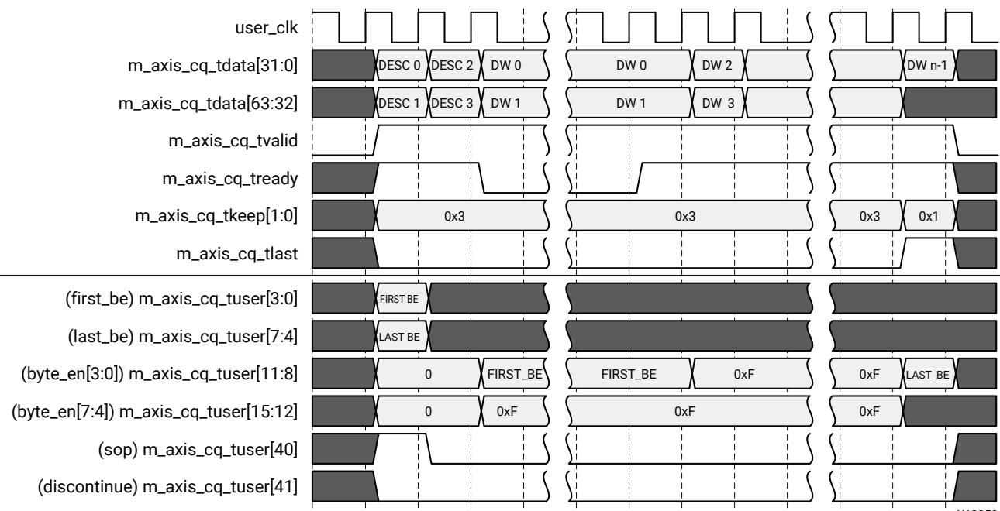

Figure 22: Memory Write Transaction on the Completer Request Interface (Dword-Aligned Mode, 128-Bit Interface)

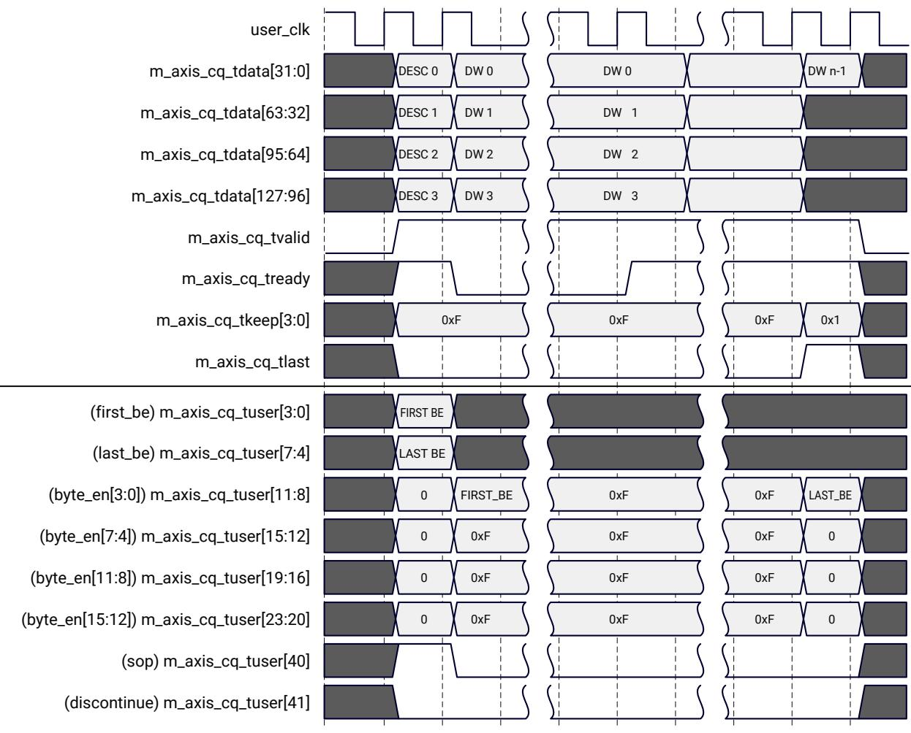

Figure 23: Memory Write Transaction on the Completer Request Interface (Dword-Aligned Mode, 256-Bit Interface)

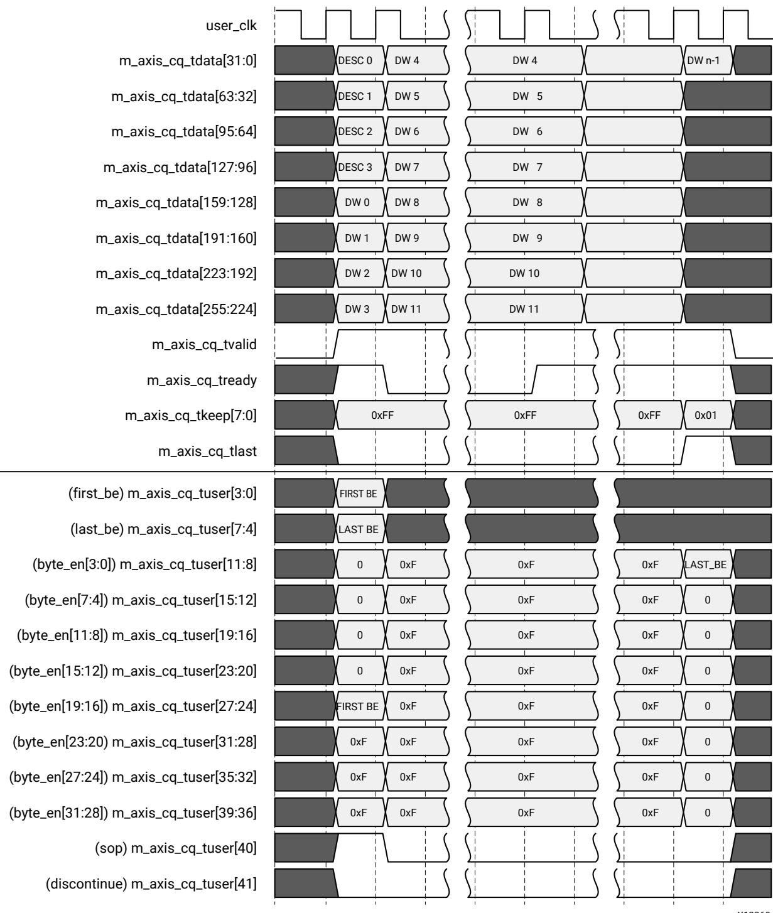

The following timing diagrams illustrate the address-aligned transfer of a memory write TLP received from the link across the CQ interface, when the interface width is configured as 64, 128 and 256 bits, respectively. For the purpose of illustration, the starting Dword address of the data block being writen into memory is assumed to be (m × 32 + 1), for an integer m > 0. Its size is assumed to be n Dwords, for some n = k × 32 + 29, k > 0. 

In the address-aligned mode, the delivery of the payload always starts in the beat following the last byte of the descriptor. The first byte of the payload can appear on any byte lane, based on the address of the first valid byte of the payload. The keep outputs m_axis_cq_tkeep remain active-High in the gap between the descriptor and the payload. The actual position of the first valid byte in the payload can be determined either from the least significant bits of the address in the descriptor or from the byte enable bits byte_en[31:0] in the m_axis_cq_tuser bus. 

For writes of two Dwords or less, the 1s on byte_en cannot be contiguous from the start of the payload. In the case of a zero-length memory write, the integrated block transfers a one-Dword payload with the byte_en bits all set to 0 for the payload bytes. 

Figure 24: Memory Write Transaction on the Completer Request Interface (Address-Aligned Mode, 64-Bit Interface)

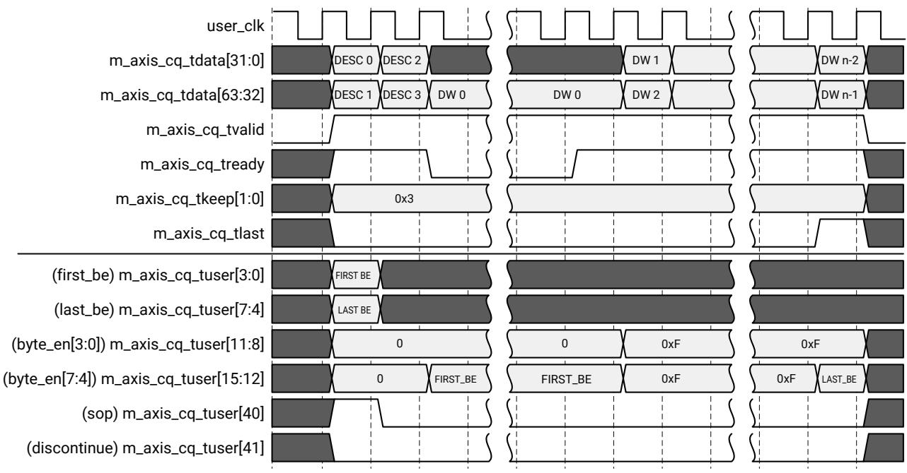

Figure 25: Memory Write Transaction on the Completer Request Interface (Address-Aligned Mode, 128-Bit Interface)

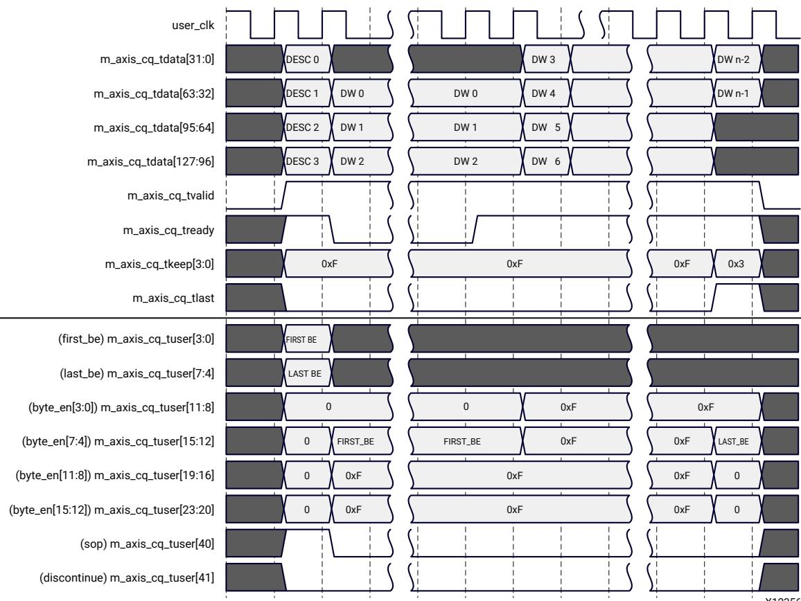

X12356

Figure 26: Memory Write Transaction on the Completer Request Interface (Address-Aligned Mode, 256-Bit Interface)

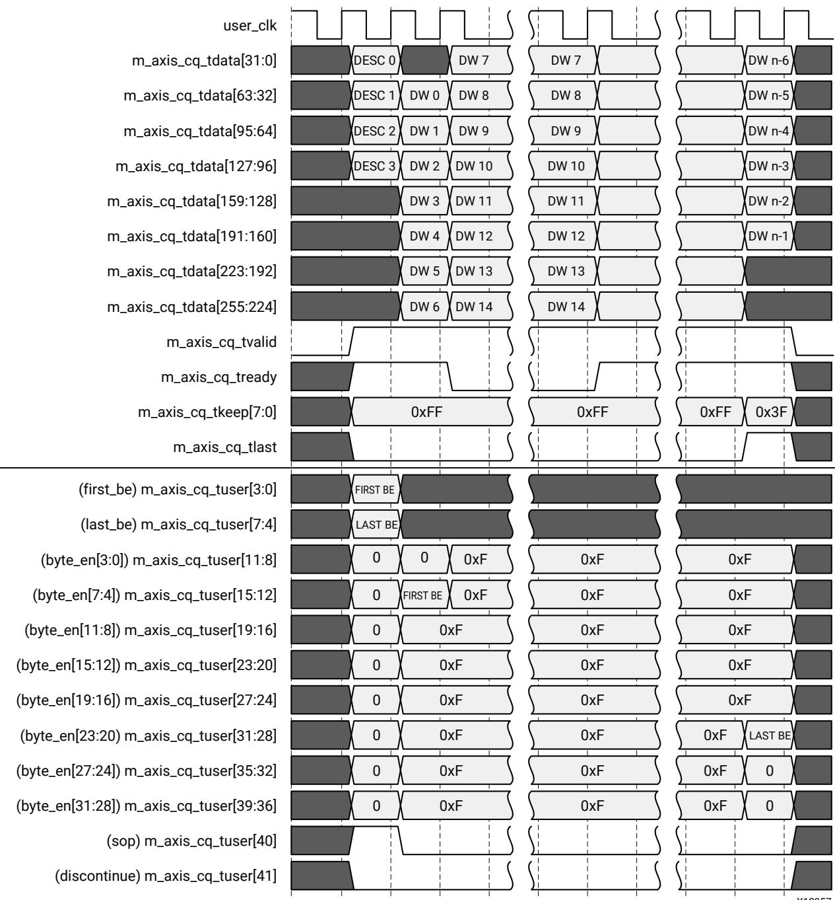

## Completer Memory Read Operation

A memory read request is transferred across the completer request interface in the same manner as a memory write request, except that the AXI4-Stream packet contains only the 16-byte descriptor. The following timing diagrams illustrate the transfer of a memory read TLP received from the link across the completer request interface, when the interface width is configured as 64, 128, and 256 bits, respectively. The packet occupies two consecutive beats on the 64-bit interface, while it is transferred in a single beat on the 128- and 256-bit interfaces. The m_axis_cq_tvalid signal remains asserted over the duration of the packet. You can prolong a beat at any time by deasserting m_axis_cq_tready. The sop signal in the m_axis_cq_tuser bus is asserted when the first descriptor byte is on the bus. 

Figure 27: Memory Read Transaction on the Completer Request Interface (64-Bit Interface)

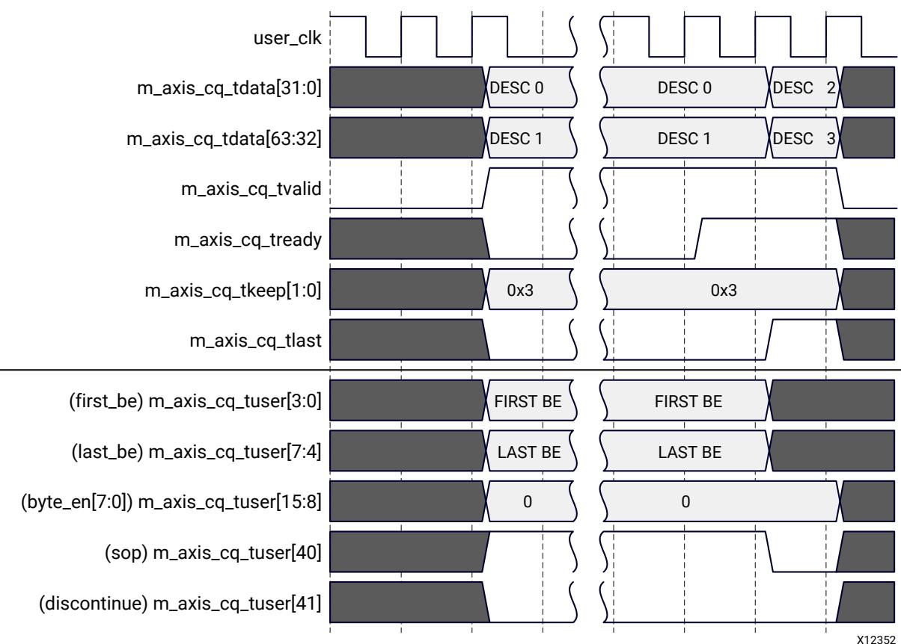

Figure 28: Memory Read Transaction on the Completer Request Interface (128-Bit Interface)

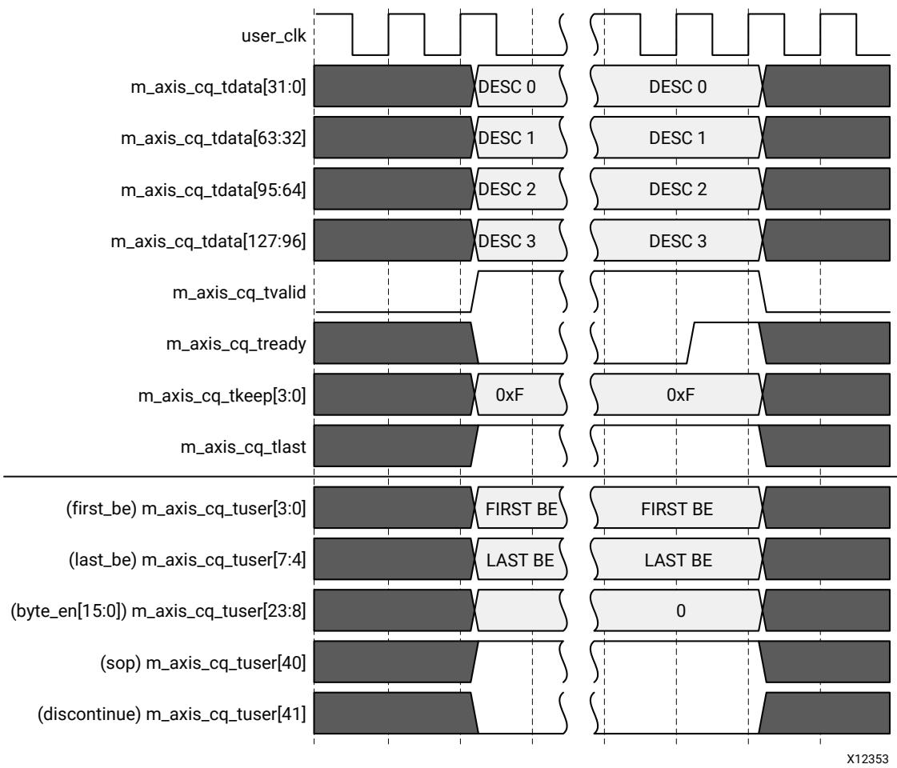

Figure 29: Memory Read Transaction on the Completer Request Interface (256-Bit Interface)

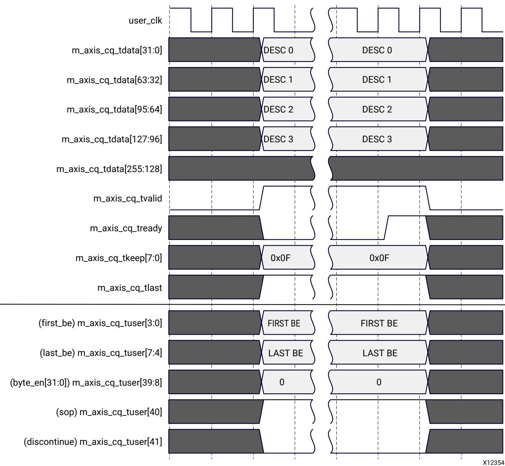

The byte enable bits associated with the read request for the first and last Dwords are supplied by the integrated block on the m_axis_cq_tuser sideband bus. These bits are valid when the first descriptor byte is being transferred, and must be used to determine the byte-level starting address and the byte count associated with the request. For the special cases of one-Dword and two-Dword reads, the byte enables can be non-contiguous. The byte enables are contiguous in all other cases. A zero-length memory read is sent on the CQ interface with the Dword count field in the descriptor set to 1 and the first and last byte enables set to 0. 

The user application must respond to each memory read request with a Completion. The data requested by the read can be sent as a single Completion or multiple Split Completions. These Completions must be sent through the Completer Completion (CC) interface of the integrated block. The Completions for two distinct requests can be sent in any order, but the Split Completions for the same request must be in order. The operation of the CC interface is described in Completer Completion Interface Operation. 

## I/O Write Operation

The transfer of an I/O write request on the CQ interface is similar to that of a memory write request with a one-Dword payload. The transfer starts with the 128-bit descriptor, followed by the one-Dword payload. When the Dword-aligned mode is in use, the payload Dword immediately follows the descriptor. When the address-alignment mode is in use, the payload Dword is supplied in a new beat after the descriptor, and its alignment in the datapath is based on the address in the descriptor. The First Byte Enable bits in the m_axis_cq_tuser indicate the valid bytes in the payload. The byte enable bits byte_en also provide this information. 

Because an I/O write is a Non-Posted transaction, the user logic must respond to it with a Completion containing no data payload. The Completions for I/O requests can be sent in any order. Errors associated with the I/O write transaction can be signaled to the requester by seting the Completion Status field in the completion descriptor to CA (Completer Abort) or UR (Unsupported Request), as is appropriate. The operation of the Completer Completion interface is described in Completer Completion Interface Operation. 

## I/O Read Operation

The transfer of an I/O read request on the CQ interface is similar to that of a memory read request, and involves only the descriptor. The length of the requested data is always one Dword, and the First Byte Enable bits in m_axis_cq_tuser indicate the valid bytes to be read. 

The user logic must respond to an I/O read request with a one-Dword Completion (or a Completion with no data in the case of an error). The Completions for two distinct I/O read requests can be sent in any order. Errors associated with an I/O read transaction can be signaled to the requester by seting the Completion Status field in the completion descriptor to CA (Completer Abort) or UR (Unsupported Request), as is appropriate. The operation of the Completer Completion interface is described in Completer Completion Interface Operation. 

## Atomic Operations on the Completer Request Interface

The transfer of an Atomic Op request on the completer request interface is similar to that of a memory write request. The payload for an Atomic Op can range from one Dword to eight Dwords, and its starting address is always aligned on a Dword boundary. The transfer starts with the 128-bit descriptor, followed by the payload. When the Dword-aligned mode is in use, the first payload Dword immediately follows the descriptor. When the address-alignment mode is in use, the payload starts in a new beat after the descriptor, and its alignment is based on the address in the descriptor. The m_axis_cq_tkeep output indicates the end of the payload. The byte_en signals in m_axis_cq_tuser also indicate the valid bytes in the payload. The First Byte Enable and Last Byte Enable bits in m_axis_cq_tuser should not be used for Atomic Operations. 

Because an Atomic Operation is a Non-Posted transaction, the user logic must respond to it with a Completion containing the result of the operation. Errors associated with the operation can be signaled to the requester by seting the Completion Status field in the completion descriptor to Completer Abort (CA) or Unsupported Request (UR), as is appropriate. The operation of the Completer Completion interface is described in Completer Completion Interface Operation. 

## Message Requests on the Completer Request Interface

The transfer of a message on the CQ interface is similar to that of a memory write request, except that a payload might not always be present. The transfer starts with the 128-bit descriptor, followed by the payload, if present. When the Dword-aligned mode is in use, the payload immediately follows the descriptor. When the address-alignment mode is in use, the first Dword of the payload is supplied in a new beat after the descriptor, and always starts in byte lane 0. You can determine the end of the payload from the states of the m_axis_cq_tlast and m_axis_cq_tkeep signals. The byte_en signals in m_axis_cq_tuser also indicate the valid bytes in the payload. The First Byte Enable and Last Byte Enable bits in m_axis_cq_tuser should not be used for Message transactions. 

## Aborting a Transfer

For any request that includes an associated payload, the integrated block can signal an error in the transferred payload by asserting the discontinue signal in the m_axis_cq_tuser bus in the last beat of the packet (along with m_axis_cq_tlast). This occurs when the integrated block has detected an uncorrectable error while reading data from its internal memories. The user application must discard the entire packet when it has detected discontinue asserted in the last beat of a packet. This condition is considered a fatal error in the integrated block. 

## Selective Flow Control for Non-Posted Requests

The PCI Express® Base Specification requires that the Completer Request interface continue to deliver Posted transactions even when the user application is unable to accept Non-Posted transactions. To enable this capability, the integrated block implements a credit-based flow control mechanism on the CQ interface through which user logic can control the flow of Non-Posted requests without afecting Posted requests. The user logic signals the availability of bufers for receive Non-Posted requests using the pcie_cq_np_req[0] signal. The core delivers a Non-Posted request only when the available credit is non-zero. The integrated block continues to deliver Posted requests while the delivery of Non-Posted requests has been paused for lack of credit. When no back pressure is applied by the credit mechanism for the delivery of Non-Posted requests, the integrated block delivers Posted and Non-Posted requests in the same order as received from the link. 

The integrated block maintains an internal credit counter to track the credit available for Non-Posted requests on the completer request interface. The following algorithm is used to keep track of the available credit: 

• On reset, the counter is set to 0. 

• After the integrated block comes out of reset, in every clock cycle: 

○ If pcie_cq_np_req[0] is active-High and no Non-Posted request is being delivered this cycle, the credit count is incremented by 1, unless it has already reached its saturation limit of 32. 

○ If pcie_cq_np_req[0] is Low and a Non-Posted request is being delivered this cycle, the credit count is decremented by 1, unless it is already 0. 

○ Otherwise, the credit count remains unchanged. 

• The integrated block starts delivery of a Non-Posted TLP only if the credit count is greater than 0. 

The user application can either provide a one-cycle pulse on pcie_cq_np_req[0] each time it is ready to receive a Non-Posted request, or keep it permanently asserted if it does not need to exercise selective back pressure of Non-Posted requests. If the credit count is always non-zero, the integrated block delivers Posted and Non-Posted requests in the same order as received from the link. If it remains 0 for some time, Non-Posted requests can accumulate in the integrated block FIFO. When the credit count becomes non-zero later, the integrated block first delivers the accumulated Non-Posted requests that arrived before Posted requests already delivered, and then reverts to delivering the requests in the order received from the link. 

The assertion and deassertion of the pcie_cq_np_req[0] signal does not need to be aligned with the packet transfers on the completer request interface. 

You can monitor the current value of the credit count on the output 

pcie_cq_np_req_count[5:0]. The counter saturates at 32. Because of internal pipeline delays, there can be several cycles of delay between the integrated block receiving a pulse on the pcie_cq_np_req[0] input and updating the pcie_cq_np_req_count[5:0] output in response. Thus, when the user application has adequate bufer space available, it should provide the credit in advance so that Non-Posted requests are not held up by the core for lack of credit. 

## Completer Completion Interface Operation

The following figure illustrates the signals associated with the completer completion interface of the core. The core delivers each TLP on this interface as an AXI4-Stream packet. 

Figure 30: Completer Completion Interface Signals

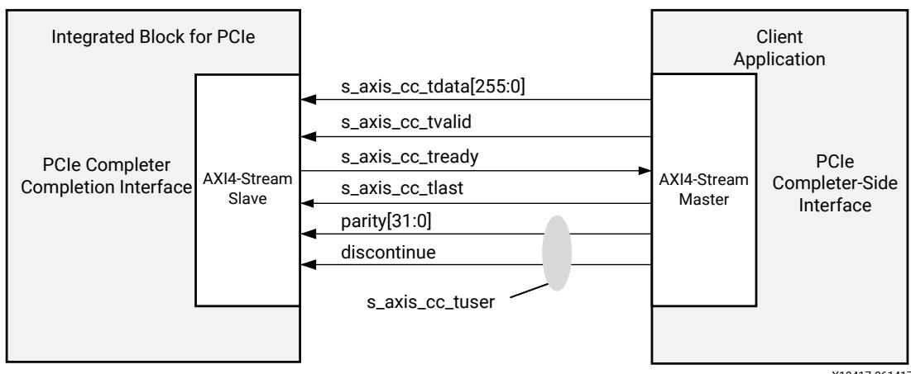

The CC interface supports two distinct data alignment modes. In the Dword-aligned mode, the first byte of valid data must be presented in lane n = (12 + A mod 4) mod w, where A is the byte-level starting address of the data block being transferred (as conveyed in the Lower Address field of the descriptor) and w the width of the interface in bytes (8, 16, or 32). In the addressaligned mode, the data always starts in a new beat after the descriptor has ended. When transferring the Completion payload for a memory or I/O read request, its first valid byte is on lane n = A mod w. For all other Completions, the payload is aligned with byte lane 0. 

## Completer Completion Descriptor Format

The user application sends completion data for a completer request to the CC interface of the integrated block as an independent AXI4-Stream packet. Each packet starts with a descriptor and can have payload data following the descriptor. The descriptor is always 12 bytes long, and is sent in the first 12 bytes of the completion packet. The descriptor is transferred during the first two beats on a 64-bit interface, and in the first beat on a 128- or 256-bit interface. When the user application splits the completion data for a request into multiple Split Completions, it must send each Split Completion as a separate AXI4-Stream packet, with its own descriptor. 

The format of the completer completion descriptor is illustrated in the following figure. The individual fields of the completer request descriptor are described in the following table. 

Figure 31: Completer Completion Descriptor Format

<table><tr><td colspan="101">63</td><td></td><td></td><td></td><td></td><td></td><td></td><td></td><td></td><td></td><td></td><td></td><td></td><td></td><td></td></tr><tr><td colspan="100">DW + 1</td><td></td><td></td><td></td><td></td><td></td><td></td><td></td><td></td><td></td><td></td><td></td><td></td><td></td><td></td><td></td></tr><tr><td>+7</td><td colspan="100">+6</td><td>0</td><td></td><td></td><td></td><td></td><td></td><td></td><td></td><td></td><td></td><td></td><td></td><td></td><td></td></tr><tr><td>7|6|5|4|3|2|1|0</td><td>7|6|5|4|3|2|1|0</td><td>7|6|5|4|3|2|1|0</td><td>7|6|5|4|3|2|1|0</td><td>7|6|5|4|3|2|1|0</td><td>7|6|5|4|3|2|1|0</td><td>7|6|5|4|3|2|1|0</td><td>7|5|4|3|2|1|0</td><td>7|6|5|4|3|2|1|0</td><td>7|6|5|4|3|2|1|0</td><td>7|6|5|4|3|2|1|0</td><td>7|6|5|4|3|2|1|0</td><td>7|6|5|4|3|2|1|0</td><td>7|6|5|3|2|1|0</td><td>7|6|5|4|3|2|1|0</td><td>7|6|5|4|3|2|1|0</td><td>7|6|5|4|3|2|1|0</td><td>7|6|5|4|3|2|1|0</td><td>7|6|5|4|3|2|1|0</td><td>7|6|5|4|3|1|0</td><td>7|6|5|4|3|2|1|0</td><td>7|6|5|4|3|2|1|0</td><td>7|6|5|4|3|2|1|0</td><td>7|6|5|4|3|2|1|0</td><td>7|6|5|4|3|2|1|0</td><td>7|6|5|4|3|2|1|R</td><td>7|6|5|4|3|2|1|0</td><td>7|6|5|4|3|2|1|0</td><td>7|6|5|4|3|2|1|0</td><td>7|6|5|4|3|2|1|0</td><td>7|6|5|4|3|2|1|0</td><td>7|6|5|4|3|2|1|0</td><td>7|0</td><td>7|6|5|4|3|2|1|0</td><td>7|6|5|4|3|2|1|0</td><td>7|6|5|4|3|2|1|0</td><td>7|6|5|4|3|2|1|0</td><td>7|6|5|4|3|2|1|0</td><td>7|6|5|4|3|2|1|0</td><td>8</td><td>8</td><td>8</td><td>8</td><td>8</td><td>8</td><td>8</td><td>8</td><td>8</td><td>8</td><td>8</td><td>8</td><td>8</td><td>8</td><td>8</td><td>8</td><td>8</td><td>8</td><td>8</td><td>8</td><td>8</td><td>8</td><td>8</td><td>8</td><td>8</td><td>8</td><td>8</td><td>8</td><td>8</td><td>8</td><td>8</td><td>8</td><td>8</td><td>8</td><td>8</td><td>8</td><td>8</td><td>8</td><td>8</td><td>8</td><td>8</td><td>8</td><td>8</td><td>8</td><td>8</td><td>8</td><td>8</td><td>8</td><td>8</td><td>8</td><td></td><td></td><td></td><td></td><td></td><td></td><td></td><td></td><td></td><td></td><td></td><td></td><td></td><td></td><td></td><td></td><td></td><td></td><td></td><td></td><td></td><td></td><td></td><td></td><td></td><td></td></tr><tr><td>Bus</td><td>Device/Function</td><td>R</td><td></td><td></td><td>Dword Count</td><td>R</td><td></td><td></td><td>Byte Count</td><td>R</td><td></td><td></td><td>AT</td><td>Address [6:0]</td><td></td><td></td><td></td><td></td><td></td><td></td><td></td><td></td><td></td><td></td><td></td><td></td><td></td><td></td><td></td><td></td><td></td><td></td><td></td><td></td><td></td><td></td><td></td><td></td><td></td><td></td><td></td><td></td><td></td><td></td><td></td><td></td><td></td><td></td><td></td><td></td><td></td><td></td><td></td><td></td><td></td><td></td><td></td><td></td><td></td><td></td><td></td><td></td><td></td><td></td><td></td><td></td><td></td><td></td><td></td><td></td><td></td><td></td><td></td><td></td><td></td><td></td><td></td><td></td><td></td><td></td><td></td><td></td><td></td><td></td><td></td><td></td><td></td><td></td><td></td><td></td><td></td><td></td><td></td><td></td><td></td><td></td><td></td><td></td><td></td><td></td><td></td><td></td><td></td><td></td><td></td><td></td><td></td><td></td><td></td><td></td><td></td><td></td><td></td><td></td></tr></table>

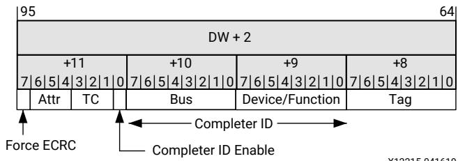

Table 52: Completer Completion Descriptor Fields

<table><tr><td>Bit Index</td><td>Field Name</td><td colspan="2">Description</td></tr><tr><td rowspan="8">6:0</td><td rowspan="8">Lower Address</td><td colspan="2">For memory read Completions, this field must be set to the least significant 7 bits of the starting byte-level address of the memory block being transferred. For the first (or only) Completion, the Completer can generate this field from the least significant 5 bits of the address of the Request concatenated with 2 bits of byte-level address formed by the byte enables for the first Dword of the Request as shown below.</td></tr><tr><td>first_be[3:0]</td><td>Lower Address[1:0]</td></tr><tr><td>4&#x27;b0000</td><td>2&#x27;b00</td></tr><tr><td>4&#x27;bxxx1</td><td>2&#x27;b00</td></tr><tr><td>4&#x27;bxx10</td><td>2&#x27;b01</td></tr><tr><td>4&#x27;bx100</td><td>2&#x27;b10</td></tr><tr><td>4&#x27;b1000</td><td>2&#x27;b11</td></tr><tr><td colspan="2">For any subsequent Completions, the Lower Address field is always zero except for Completions generated by a Root Complex with a Read Completion Boundary (RCB) value of 64 bytes. In this case the least significant 6 bits of the Lower Address field is always zero and the most significant bit of the Lower Address field toggles according to the alignment of the 64-byte data payload.For all other Completions, the Lower Address must be set to all zeros.</td></tr><tr><td>9:8</td><td>Address Type</td><td colspan="2">This field is defined for Completions of memory transactions and Atomic Operations only. For these Completions, the user logic must copy the AT bits from the corresponding request descriptor into this field. This field must be set to 0 for all other Completions.</td></tr></table>

Table 52: Completer Completion Descriptor Fields (cont'd)

<table><tr><td>Bit Index</td><td>Field Name</td><td>Description</td></tr><tr><td>28:16</td><td>Byte Count</td><td>These 13 bits can have values in the range of 0 - 4,096 bytes. If a Memory Read Request is completed using a single Completion, the Byte Count value indicates Payload size in bytes. This field must be set to 4 for I/O read Completions and I/O write Completions. The byte count must be set to 1 while sending a Completion for a zero-length memory read, and a dummy payload of 1 Dword must follow the descriptor.For each Memory Read Completion, the Byte Count field must indicate the remaining number of bytes required to complete the Request, including the number of bytes returned with the Completion.If a Memory Read Request is completed using multiple Completions, the Byte Count value for each successive Completion is the value indicated by the preceding Completion minus the number of bytes returned with the preceding Completion. The total number of bytes required to complete a Memory Read Request is calculated as shown in the following table.MSB of the Byte Count field is reserved.</td></tr><tr><td>29</td><td>Locked Read Completion</td><td>This bit must be set when the Completion is in response to a Locked Read request. It must be set to 0 for all other Completions.</td></tr><tr><td>42:32</td><td>Dword Count</td><td>These 11 bits indicate the size of the payload of the current packet in Dwords. Its range is 0 - 1K Dwords. This field must be set to 1 for I/O read Completions and 0 for I/O write Completions. The Dword count must be set to 1 while sending a Completion for a zero-length memory read. The Dword count must be set to 0 when sending a UR or CA Completion. In all other cases, the Dword count must correspond to the actual number of Dwords in the payload of the current packet.</td></tr><tr><td>45:43</td><td>Completion Status</td><td>These bits must be set based on the type of Completion being sent. The only valid settings are:000: Successful Completion001: Unsupported Request (UR)100: Completer Abort (CA)</td></tr><tr><td>46</td><td>Completion Status</td><td>This bit can be used to poison the Completion TLP being sent. This bit must be set to 0 for all Completions, except when the user application detects an error in the block of data following the descriptor and wants to communicate this information using the Data Poisoning feature of PCI Express.</td></tr><tr><td>63:48</td><td>Requester ID</td><td>PCI Requester ID associated with the request (copied from the request).</td></tr><tr><td>71:64</td><td>Tag</td><td>PCI Express Tag associated with the request (copied from the request).</td></tr></table>

Table 52: Completer Completion Descriptor Fields (cont'd)

<table><tr><td>Bit Index</td><td>Field Name</td><td>Description</td></tr><tr><td>79:72</td><td>Target Function/Device Number</td><td>Device and/or Function number of the Completer Function. Endpoint mode:ARI enabled:Bits [79:72] must be set to the Completer Function number.ARI disabled:Bits [74:72] must be set to the Completer Function number.Bits [79:75] are not usedUpstream Port for Switch use case (Endpoint mode is selected within the IP):ARI enabled:Bits [79:72] must be set to the Completer Function number.ARI disabled:Bits [74:72] must be set to the Completer Function number.Bits [79:75] are not used if the Completion is originating from the switch itself. These bits must be set to the Completer Device number where the Completion was originated if the switch is relaying the Completion (Completer is external to the switch). This is used in conjunction with Completer ID Enable bit in the descriptor.Root Port mode (Downstream Port):ARI enabled:Bits [79:72] must be set to the Completer Function number.ARI disabled:Bits [74:72] must be set to the Completer Function number.Bits [79:75] must be set to the Completer Device number. This is used in conjunction with Completer ID Enable bit in the descriptor.</td></tr><tr><td>87:80</td><td>Completer Bus Number</td><td>Bus number associated with the Completer Function. Endpoint mode:Not UsedUpstream Port for Switch use case (Endpoint mode is selected within the IP):Not used if the Completion is originating from the switch itself. These bits must be set to the Completer Bus number where the Completion was originated if the switch is relaying the Completion (Completer is external to the switch). This is used in conjunction with Completer ID Enable bit in the descriptor.Root Port mode (Downstream Port):Must be set to the Completer Bus number. This is used in conjunction with Completer ID Enable bit in the descriptor.</td></tr></table>

Table 52: Completer Completion Descriptor Fields (cont'd)

<table><tr><td>Bit Index</td><td>Field Name</td><td>Description</td></tr><tr><td>88</td><td>Completer ID Enable</td><td>Values are:1&#x27;b1: The client supplies Bus, Device, and Function numbers in the descriptor to be populated as the Completer ID field in the TLP header.1&#x27;b0: IP uses Bus and Device numbers captured from received Configuration requests and the client supplies Function numbers in the descriptor to be populated as the Completer ID field in the TLP header. Endpoint mode:Must be set to 1&#x27;b0.Upstream Port for Switch use case (Endpoint mode is selected within the IP):Set to 1&#x27;b0 when the Completion is originating from the switch itself.Set to 1&#x27;b1 when the switch is relaying the Completion (Completer is external to the switch). This is used in conjunction with Completer Bus Number bits [95:88] and Completer Function/Device Number bits [87:83] when ARI is not enabled.Root Port mode:Must be set to 1&#x27;b1. This is used in conjunction with Completer Bus Number bits [95:88] and Completer Function/Device Number bits [87:83] when ARI is not enabled.</td></tr><tr><td>91:89</td><td>Transaction Class (TC)</td><td>PCIe Transaction Class (TC) associated with the request. The user application must copy this value from the TC field of the associated request descriptor.</td></tr><tr><td>94:92</td><td>Attributes</td><td>PCIe attributes associated with the request (copied from the request). Bit 92 is the No Snoop bit, bit 93 is the Relaxed Ordering bit, and bit 94 is the ID-Based Ordering bit.</td></tr><tr><td>95</td><td>Force ECRC</td><td>Force ECRC insertion. Setting this bit to 1 forces the integrated block to append a TLP Digest containing ECRC to the Completion TLP, even when ECRC is not enabled for the Function sending the Completion.</td></tr></table>

Table 53: Calculating Byte Count from Completer Request first_be[3:0], last_be[3:0], Dword Count[10:0]

<table><tr><td>first_be[3:0]</td><td>last_be[3:0]</td><td>Total Byte Count</td></tr><tr><td>1xx1</td><td>0000</td><td>4</td></tr><tr><td>01x1</td><td>0000</td><td>3</td></tr><tr><td>1x10</td><td>0000</td><td>3</td></tr><tr><td>0011</td><td>0000</td><td>2</td></tr><tr><td>0110</td><td>0000</td><td>2</td></tr><tr><td>1100</td><td>0000</td><td>2</td></tr><tr><td>0001</td><td>0000</td><td>1</td></tr><tr><td>0010</td><td>0000</td><td>1</td></tr><tr><td>0100</td><td>0000</td><td>1</td></tr><tr><td>1000</td><td>0000</td><td>1</td></tr><tr><td>0000</td><td>0000</td><td>1</td></tr></table>

Table 53: Calculating Byte Count from Completer Request first_be[3:0], last_be[3:0], Dword Count[10:0] (cont'd)

<table><tr><td>first_be[3:0]</td><td>last_be[3:0]</td><td>Total Byte Count</td></tr><tr><td>xxx1</td><td>1xxx</td><td>Dword_count × 4</td></tr><tr><td>xxx1</td><td>01xx</td><td>(Dword_count × 4)-1</td></tr><tr><td>xxx1</td><td>001x</td><td>(Dword_count × 4)-2</td></tr><tr><td>xxx1</td><td>0001</td><td>(Dword_count × 4)-3</td></tr><tr><td>xx10</td><td>1xxx</td><td>(Dword_count × 4)-1</td></tr><tr><td>xx10</td><td>01xx</td><td>(Dword_count × 4)-2</td></tr><tr><td>xx10</td><td>001x</td><td>(Dword_count × 4)-3</td></tr><tr><td>xx10</td><td>0001</td><td>(Dword_count × 4)-4</td></tr><tr><td>x100</td><td>1xxx</td><td>(Dword_count × 4)-2</td></tr><tr><td>x100</td><td>01xx</td><td>(Dword_count × 4)-3</td></tr><tr><td>x100</td><td>001x</td><td>(Dword_count × 4)-4</td></tr><tr><td>x100</td><td>0001</td><td>(Dword_count × 4)-5</td></tr><tr><td>1000</td><td>1xxx</td><td>(Dword_count × 4)-3</td></tr><tr><td>1000</td><td>01xx</td><td>(Dword_count × 4)-4</td></tr><tr><td>1000</td><td>001x</td><td>(Dword_count × 4)-5</td></tr><tr><td>1000</td><td>0001</td><td>(Dword_count × 4)-6</td></tr></table>

## Completions with Successful Completion Status

The user application must return a Completion to the CC interface of the core for every Non-Posted request it receives from the completer request interface. When the request completes with no errors, the user application must return a Completion with Successful Completion (SC) status. Such a Completion might or might not contain a payload, depending on the type of request. Furthermore, the data associated with the request can be broken up into multiple Split Completions when the size of the data block exceeds the maximum payload size configured. The user logic is responsible for spliting the data block into multiple Split Completions when needed. The user application must transfer each Split Completion over the completer completion interface as a separate AXI4-Stream packet, with its own 12-byte descriptor. 

In the example timing diagrams of this section, the starting Dword address of the data block being transferred (as conveyed in bits [6:2] of the Lower Address field of the descriptor) is assumed to be (m × 8 + 1), for an integer m. The size of the data block is assumed to be n Dwords, for some n = k × 32 + 28, k > 0. 

The CC interface supports two data alignment modes: Dword-aligned and address-aligned. The following timing diagrams illustrate the Dword-aligned transfer of a Completion from the user application across the CC interface, when the interface width is configured as 64, 128, and 256 bits, respectively. In this case, the first Dword of the payload starts immediately after the descriptor. When the data block is not a multiple of four bytes, or when the start of the payload is not aligned on a Dword address boundary, the user application must add null bytes to align the start of the payload on a Dword boundary and make the payload a multiple of Dwords. For example, when the data block starts at byte address 7 and has a size of 3 bytes, the user application must add three null bytes before the first byte and two null bytes at the end of the block to make it two Dwords long. Also, in the case of non-contiguous reads, not all bytes in the data block returned are valid. In that case, the user application must return the valid bytes in the proper positions, with null bytes added in gaps between valid bytes, when needed. The interface does not have any signals to indicate the valid bytes in the payload. This is not required, as the requester is responsible for keeping track of the byte enables in the request and discarding invalid bytes from the Completion. 

In the Dword-aligned mode, the transfer starts with the 12 descriptor bytes, followed immediately by the payload bytes. The user application must keep the s_axis_cc_tvalid signal asserted over the duration of the packet. The integrated block treats the deassertion of s_axis_cc_tvalid during the packet transfer as an error, and nullifies the corresponding Completion TLP transmited on the link to avoid data corruption. 

The user application must also assert the s_axis_cc_tlast signal in the last beat of the packet. The integrated block can deassert s_axis_cc_tready in any cycle if it is not ready to accept data. The user application must not change the values on the CC interface during a clock cycle that the integrated block has deasserted s_axis_cc_tready. 

Figure 32: Transfer of a Normal Completion on the Completer Completion Interface (Dword-Aligned Mode, 64-Bit Interface)

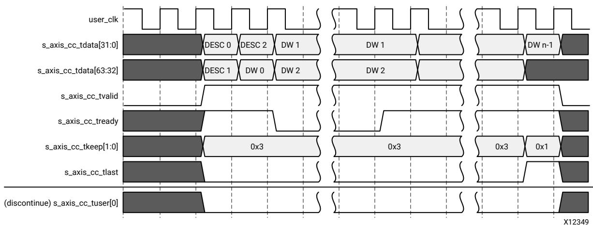

Figure 33: Transfer of a Normal Completion on the Completer Completion Interface (Dword-Aligned Mode, 128-Bit Interface)

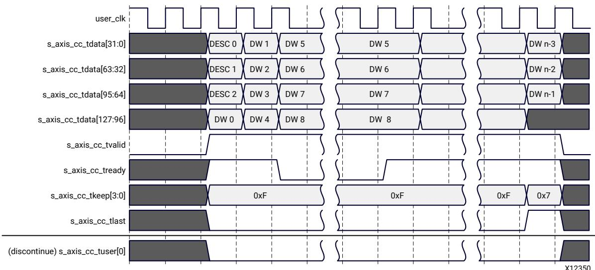

Figure 34: Transfer of a Normal Completion on the Completer Completion Interface (Dword-Aligned Mode, 256-Bit Interface)

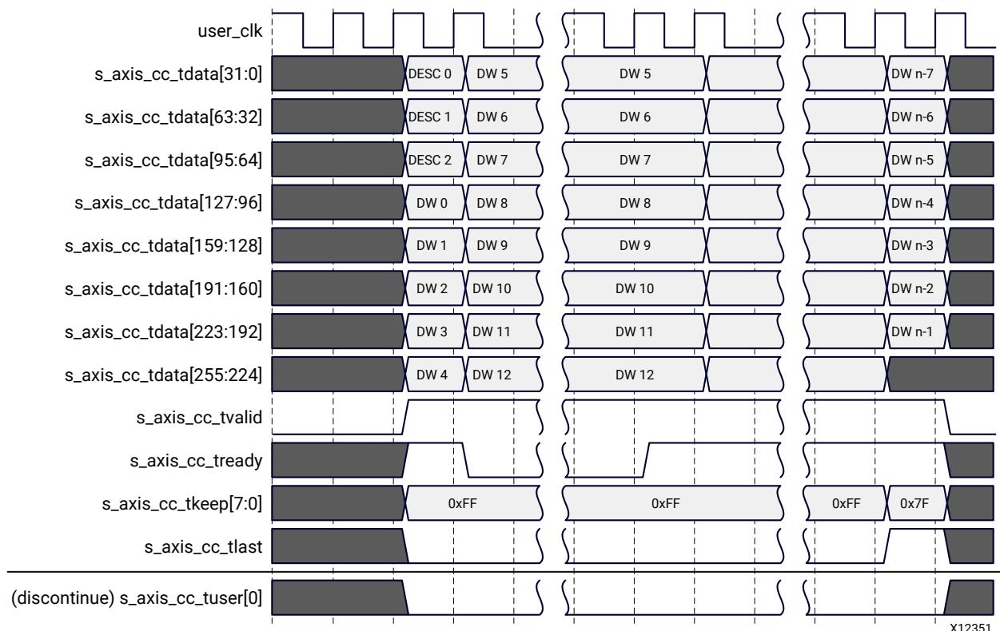

In the address-aligned mode, the delivery of the payload always starts in the beat following the last byte of the descriptor. For memory read Completions, the first byte of the payload can appear on any byte lane, based on the address of the first valid byte of the payload. For all other Completions, the payload must start in byte lane 0. 

The following timing diagrams illustrate the address-aligned transfer of a memory read Completion across the completer completion interface, when the interface width is configured as 64, 128, and 256 bits, respectively. For the purpose of illustration, the starting Dword address of the data block being transferred (as conveyed in bits [6:2] of the Lower Address field of the descriptor) is assumed to be (m × 8 +1), for some integer m. The size of the data block is assumed to be n Dwords, for some n = k × 32 + 28, k > 0. 

Figure 35: Transfer of a Normal Completion on the Completer Completion Interface (Address-Aligned Mode, 64-Bit Interface)

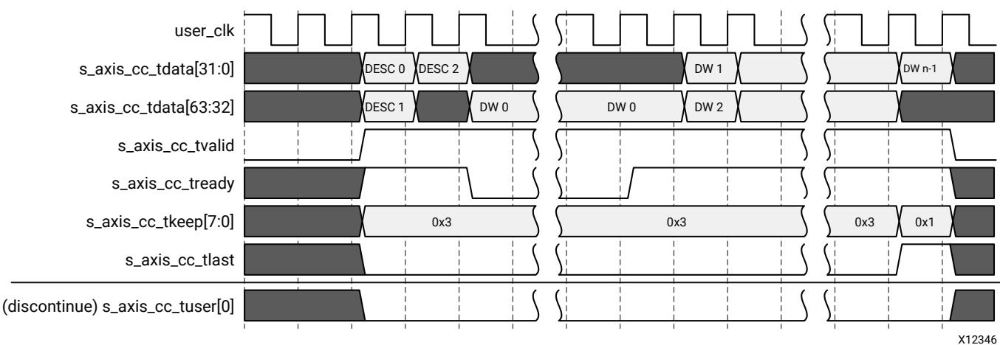

Figure 36: Transfer of a Normal Completion on the Completer Completion Interface (Address-Aligned Mode, 128-Bit Interface)

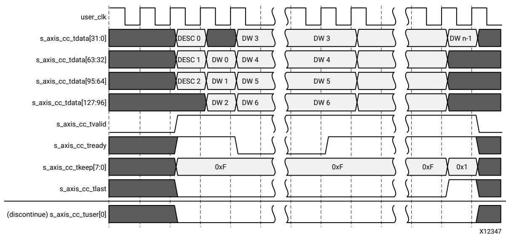

Figure 37: Transfer of a Normal Completion on the Completer Completion Interface (Address-Aligned Mode, 256-Bit Interface)

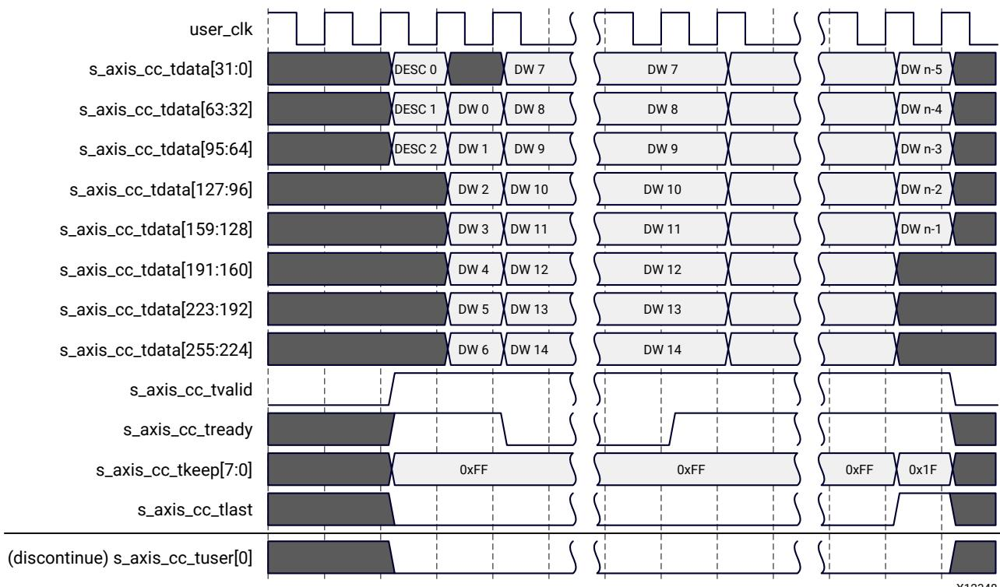

## Aborting a Completion Transfer

The user application can abort the transfer of a completion transaction on the completer completion interface at any time during the transfer of the payload by asserting the discontinue signal in the s_axis_cc_tuser bus. The integrated block nullifies the corresponding TLP on the link to avoid data corruption. 

The user application can assert this signal in any cycle during the transfer, when the Completion being transferred has an associated payload. The user application can either choose to terminate the packet prematurely in the cycle where the error was signaled (by asserting s_axis_cc_tlast), or can continue until all bytes of the payload are delivered to the integrated block. In the later case, the integrated block treats the error as sticky for the following beats of the packet, even if the user application deasserts the discontinue signal before reaching the end of the packet. 

The discontinue signal can be asserted only when s_axis_cc_tvalid is active-High. The integrated block samples this signal when s_axis_cc_tvalid and s_axis_cc_tready are both asserted. Thus, after assertion, the discontinue signal should not be deasserted until s_axis_cc_tready is asserted. 

When the integrated block is configured as an Endpoint, this error is reported by the integrated block to the Root Complex to which it is atached, as an Uncorrectable Internal Error using the Advanced Error Reporting (AER) mechanisms. 

## Completions with Error Status (UR and CA)

When responding to a request received on the completer request interface with an Unsupported Request (UR) or Completion Abort (CA) status, the user application must send a three-Dword completion descriptor in the format of the Completer Completion Descriptor Format figure in Completer Completion Descriptor Format, followed by five additional Dwords containing information on the request that generated the Completion. These five Dwords are necessary for the integrated block to log information about the request in its AER header log registers. 

The following figure shows the sequence of information transferred when sending a Completion with UR or CA status. The information is formated as an AXI4-Stream packet with a total of 8 Dwords, which are organized as follows: 

• The first three Dwords contain the completion descriptor in the format of the Completer Completion Descriptor Format figure in Completer Completion Descriptor Format. 

• The fourth Dword contains the state of the following signals in m_axis_cq_tuser, copied from the request: 

○ The First Byte Enable bits first_be[3:0] in m_axis_cq_tuser. 

○ The Last Byte Enable bits last_be[3:0] in m_axis_cq_tuser. 

○ Signals carrying information on Transaction Processing Hint: tph_present, tph_type[1:0], and tph_st_tag[7:0] in m_axis_cq_tuser. 

Figure 38: Composition of the AXI4-Stream Packet for UR and CA Completions

<table><tr><td>DW 1</td><td>DW 0</td></tr><tr><td>Completion Descriptor DW 1</td><td>Completion Descriptor DW 0</td></tr></table>

<table><tr><td colspan="4">63</td><td colspan="2">32</td></tr><tr><td colspan="5">DW 3</td><td>DW 2</td></tr><tr><td>+7</td><td>+6</td><td colspan="2">+5</td><td>+4</td><td rowspan="2">Completion Descriptor DW 2</td></tr><tr><td>7|6|5|4|3|2|1|0</td><td>7|6|5|4|3|2|1|0</td><td colspan="2">7|6|5|4|3|2|1|0</td><td>7|6|5|4|3|2|1|0</td></tr><tr><td>R</td><td>tph_st_tag</td><td>R</td><td></td><td>last_be</td><td>first_be</td></tr></table>

<table><tr><td>DW 5</td><td>DW 4</td></tr><tr><td>Request Descriptor, DW 1</td><td>Request Descriptor, DW 0</td></tr></table>

<table><tr><td>DW 7</td><td>DW</td></tr><tr><td>Request Descriptor, DW 3</td><td>Request Descriptor, DW 2</td></tr></table>

X12245 

The entire packet takes four beats on the 64-bit interface, two beats on the 128-bit interface, and a single beat on the 256-bit interface. The packet is transferred in an identical manner in both the Dword-aligned mode and the address-aligned mode, with the Dwords packed together. The user application must keep the s_axis_cc_tvalid signal asserted over the duration of the packet. It must also assert the s_axis_cc_tlast signal in the last beat of the packet. The integrated block can deassert s_axis_cc_tready in any cycle if it is not ready to accept. The user application must not change the values on the CC interface in any cycle that the integrated block has deasserted s_axis_cc_tready. 

## 64/128/256-Bit Requester Interface

The requester interface enables a user Endpoint application to initiate PCIe transactions as a bus master across the PCIe link to the host memory. For Root Complexes, this interface is also used to initiate I/O and configuration requests. This interface can also be used by both Endpoints and Root Complexes to send messages on the PCIe® link. The transactions on this interface are similar to those on the completer interface, except that the roles of the core and the user application are reversed. Posted transactions are performed as single indivisible operations and Non-Posted transactions as split transactions. 

The requester interface consists of two separate interfaces, one for data transfer in each direction. Each interface is based on the AXI4-Stream protocol, and its width can be configured as 64, 128, or 256 bits. The Requester reQuest (RQ) interface is for transfer of requests (with any associated payload data) from the user application to the integrated block, and the Requester Completion (RC) interface is used by the integrated block to deliver Completions received from the link (for Non-Posted requests) to the user application. The two interfaces operate independently. That is, the user application can transfer new requests over the RQ interface while receiving a completion for a previous request. 

## Requester Request Interface Operation

On the RQ interface, the user application delivers each TLP as an AXI4-Stream packet. The packet starts with a 128-bit descriptor, followed by data in the case of TLPs with a payload. The following figure shows the signals associated with the requester request interface. 